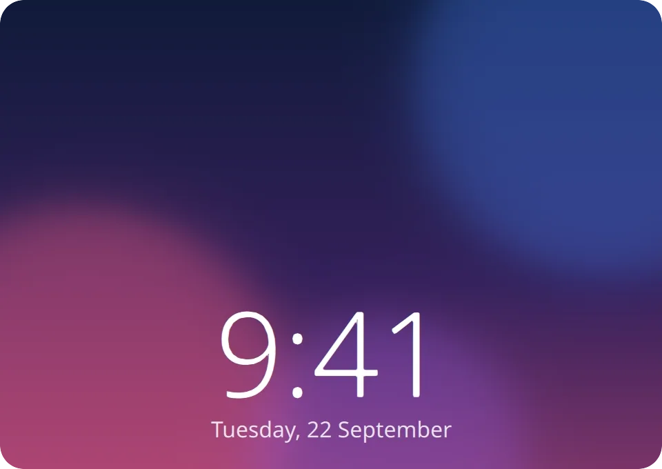
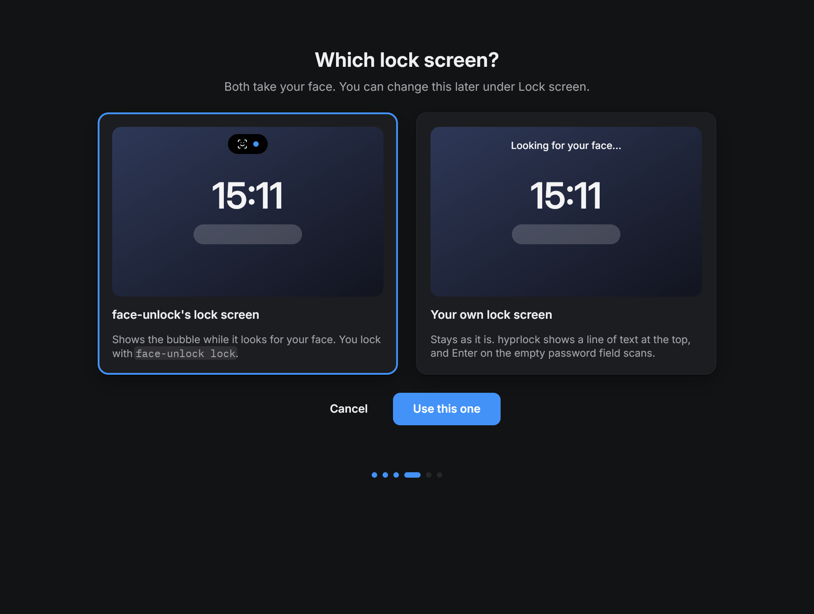
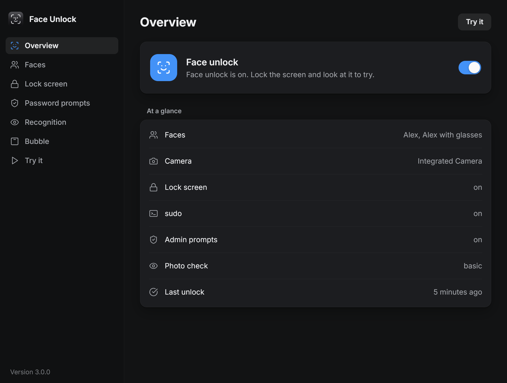
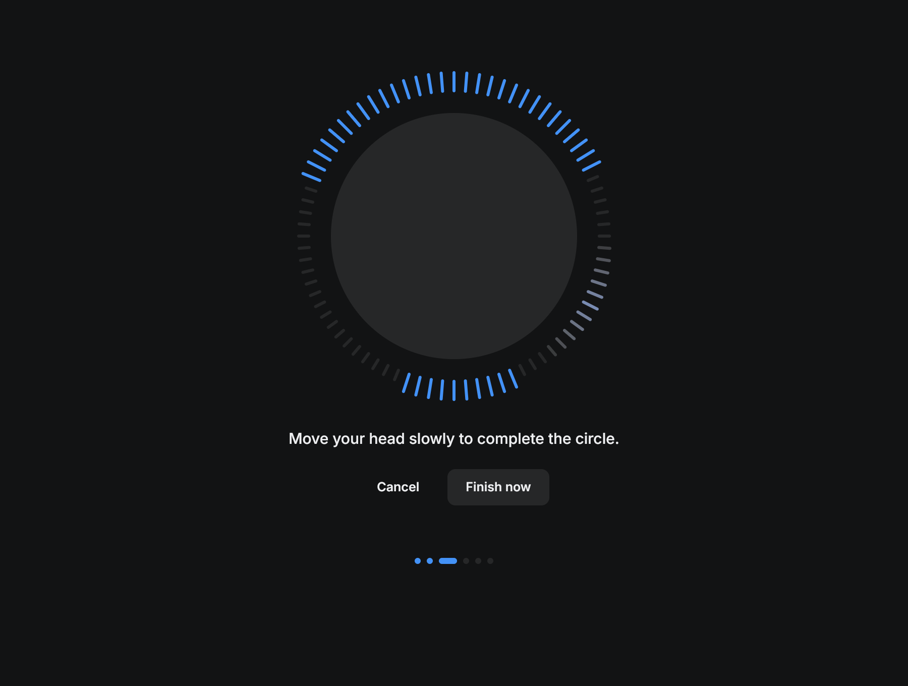
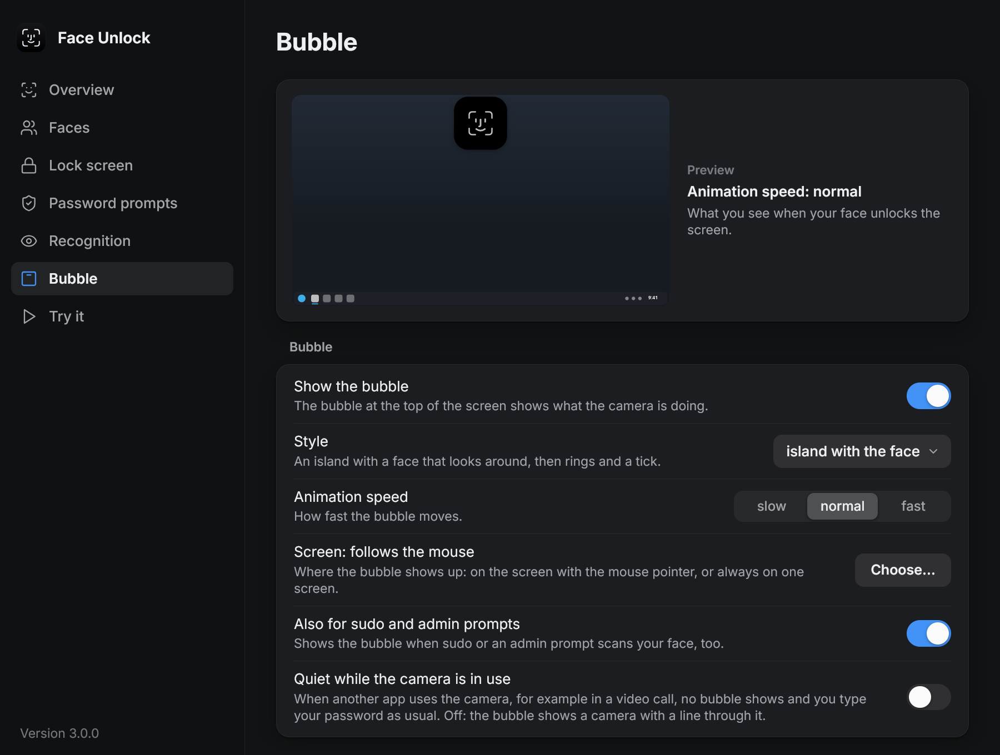
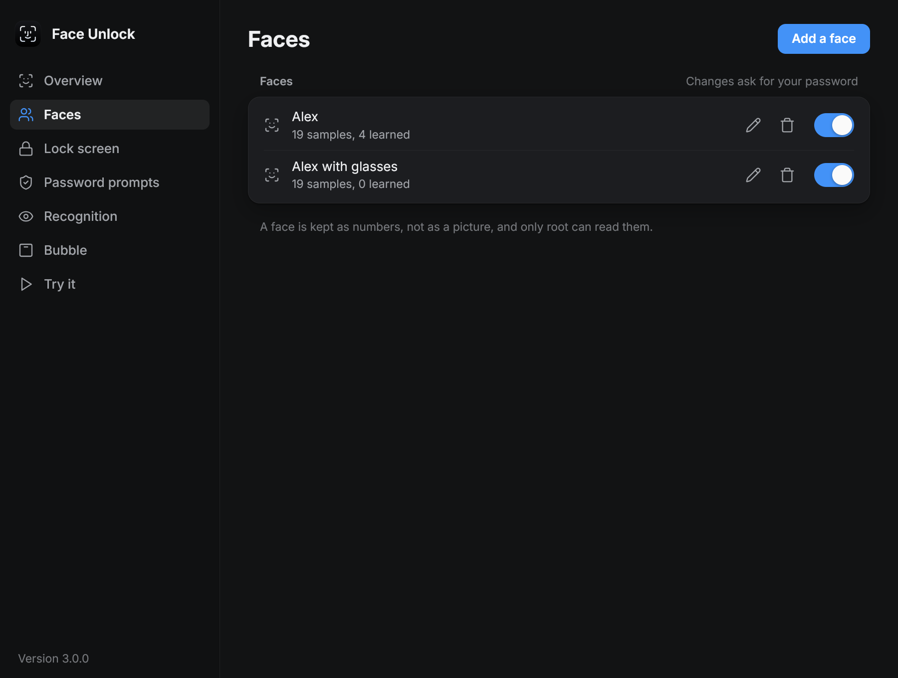
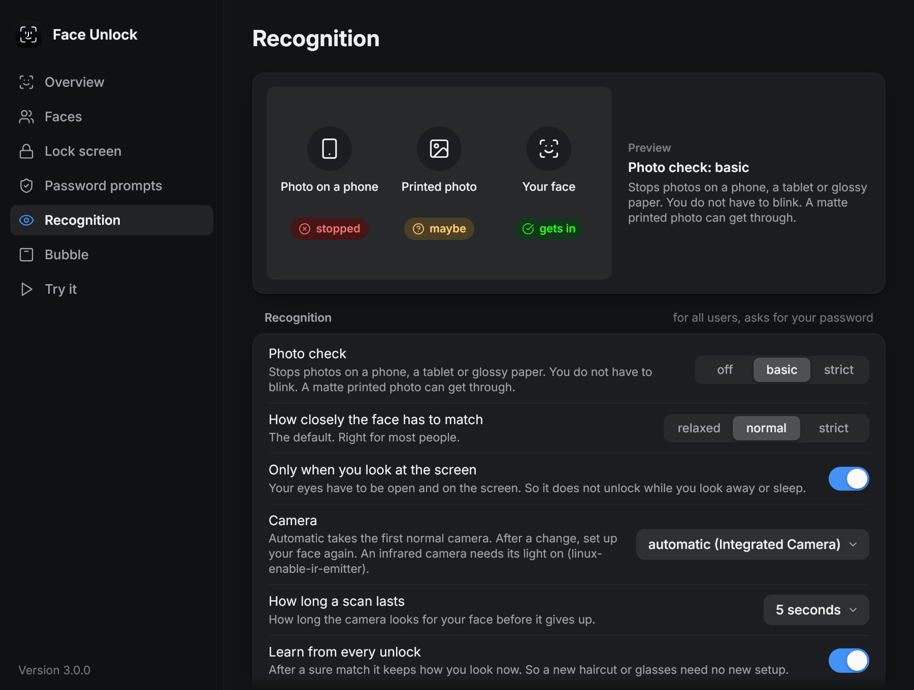
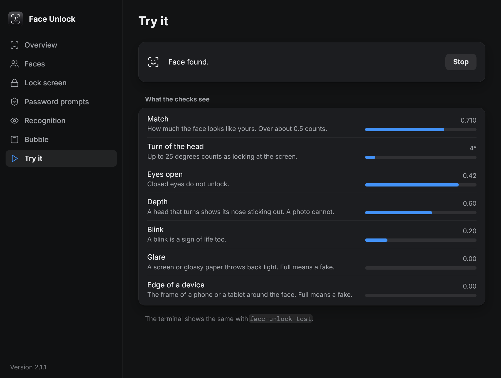
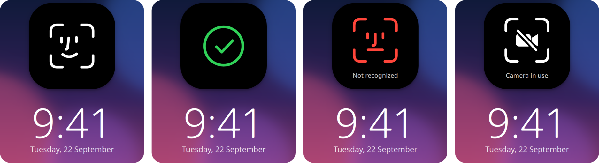
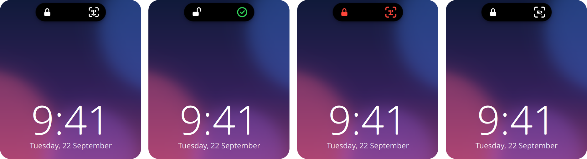

<p align="center">
  
</p>

<h1 align="center">face-unlock</h1>

<h3 align="center">Face ID for Linux.</h3>

<p align="center">
  Unlock the lock screen, sudo and admin prompts with your face.<br>
  On KDE Plasma, GNOME, Hyprland and Niri.
</p>

<h5 align="center">
  <a href="#install">Install</a> |
  <a href="#how-to-use">How to use</a> |
  <a href="#is-it-safe">Is it safe?</a> |
  <a href="https://github.com/LoonixTools/face-unlock/issues">Report a bug</a>
</h5>

<p align="center">
  <a href="https://ko-fi.com/felitendo"></a>
</p>

<p align="center">
  
</p>

<p align="center">
  
</p>

## Install

<details>
<summary><b>Arch</b>, CachyOS, EndeavourOS, Manjaro</summary>

```bash
yay -S face-unlock
```

</details>

<details>
<summary><b>Fedora</b></summary>

```bash
sudo curl -fsSL -o /etc/yum.repos.d/face-unlock.repo \
  https://loonixtools.github.io/face-unlock/face-unlock.repo
sudo dnf install face-unlock
```

</details>

<details>
<summary><b>Debian</b>, Ubuntu</summary>

```bash
codename="$(sed -n 's/^VERSION_CODENAME=//p' /etc/os-release)"
sudo install -d -m 0755 /etc/apt/keyrings
curl -fsSL https://loonixtools.github.io/face-unlock/KEY.gpg \
  | sudo gpg --dearmor -o /etc/apt/keyrings/face-unlock.gpg
echo "deb [signed-by=/etc/apt/keyrings/face-unlock.gpg] https://loonixtools.github.io/face-unlock/deb/$codename ./" \
  | sudo tee /etc/apt/sources.list.d/face-unlock.list
sudo apt update && sudo apt install face-unlock
```

</details>

- **KDE Plasma:** works out of the box.
- **GNOME:** log out and back in once after installing.
- **Hyprland and Niri:** the bubble only shows on face-unlock's own lock screen.
  hyprlock shows a line of text at the top instead. You also need a polkit
  agent. If none runs, the window shows how to install one.

<details>
<summary>Hyprland and Niri: which lock screen?</summary>

<p align="center">
  
</p>

When you turn face unlock on, the window asks which lock screen you want. You
can change it later under **Lock screen**.

- **face-unlock's own:** the bubble, the time and your wallpaper. You lock with
  `face-unlock lock`, and the window shows where to put that.
- **Yours** (hyprlock, swaylock, gtklock or waylock): press Enter on the empty
  password field to scan. hyprlock and swaylock also scan when you come back.

Hyprland without uwsm needs a line in its config. The window shows it.

</details>

## How to use

Open **Face Unlock** from your app menu, or run:

```bash
face-unlock
```

The first time, it walks you through setting up your face. Then lock the screen
and look at it.

<p align="center">
  
</p>

<details>
<summary>Setting up a face</summary>

<p align="center">
  
</p>

</details>

<details>
<summary>Settings</summary>

A preview at the top of a page shows what a setting does before it happens, on a small copy of
your desktop with your wallpaper: the bubble moves at the speed you pick, the lock screen opens the
way it will, and small pictures show who gets in.

<p align="center">
  
</p>

<p align="center">
  
</p>

<p align="center">
  
</p>

<p align="center">
  
</p>

</details>

<details>
<summary>In a terminal</summary>

| | |
|---|---|
| `face-unlock enable` | Turn it on. Sets up a face first if there is none. |
| `face-unlock disable` | Turn it off. The faces are kept. |
| `face-unlock setup` | Add a face. |
| `face-unlock faces` | List the faces. |
| `face-unlock test` | One scan, with what the checks see. |
| `face-unlock status` | What is on. |
| `face-unlock lock` | Lock the screen. |

</details>

<details>
<summary>All bubble states</summary>

<p align="center">
  
</p>

<p align="center">
  
</p>

</details>

## Is it safe?

It is a convenience upgrade, not extra security. Your webcam only sees a flat picture, so
it cannot always differentiate your face from a good fake. But the tool does everything in its power to prevent that:

- Photos and videos on a phone, tablet or glossy screen are caught.
- A matte printed photo is caught when **Anti-spoofing** is set to *strict*.

But a video of you on a big matte screen could get in.

After five failed attempts, face unlock pauses for 15 minutes. Your face is kept as
numbers, not pictures, and only root can read them. sudo over SSH asks for the
password, unless you turn that on.

## More

<details>
<summary>How it works</summary>

| | |
|---|---|
| `face-unlockd` | The root service. Owns the camera and the face data. |
| `face-unlock-agent` | Runs in your session. Watches the lock screen, draws the bubble. |
| `pam_face_unlock.so` | Lets sudo and admin prompts ask the service. |
| `face-unlock` | The command. Without one, it opens the window. |
| `face-unlock-gui` | The window. |

Two small networks from the OpenCV model zoo run on the CPU: YuNet finds the face, SFace turns it
into numbers. All details: `man face-unlock`.

</details>

<details>
<summary>Build from source</summary>

```bash
make models
make
make test
sudo make install
```

Needs Rust 1.88 or newer, Linux-PAM and libxkbcommon. The window needs Vulkan.

</details>

## Credits

- [Glance](https://github.com/jonnyoo/glance) by Jonathan Zhou: the idea and the look of the bubble.
- [Rune](https://github.com/anomalyco/rune): the window.
- [YuNet](https://github.com/opencv/opencv_zoo/tree/main/models/face_detection_yunet) and
  [SFace](https://github.com/opencv/opencv_zoo/tree/main/models/face_recognition_sface) from the
  OpenCV model zoo.

GPL-3.0-or-later.
